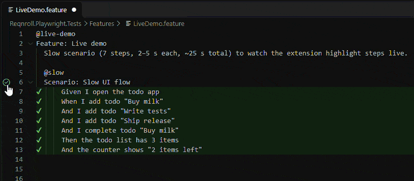

# Reqnroll Step Highlighter

See which **steps** of your [Reqnroll](https://reqnroll.net) scenarios passed, failed or were skipped –
right in the `.feature` file, **live while the tests run**. Like IntelliJ does for Cucumber/Java.



| Mark | Meaning |
|---|---|
| ▶ | running now |
| ✔ | passed |
| ✘ | failed (error message on hover) |
| ? | undefined – no matching step definition |
| … | pending – step definition not implemented yet |
| ○ | skipped (an earlier step did not pass) |

Hover a step to see its status, duration and error. Scenario Outlines show the worst result across example rows,
with one line per row in the hover.

## Why

Reqnroll turns every scenario into one NUnit / xUnit / MSTest test, so the Test Explorer only knows scenarios.
When a 5-minute UI scenario fails you get a stack trace – not the step. This extension shows the step.

## Setup

1. Add the companion Reqnroll plugin to your test project – no code needed:

   ```bash
   dotnet add package StepHighlighter.ReqnrollPlugin
   ```

2. Add `.reqnroll/` to `.gitignore` (the plugin writes results there, next to your `.sln`).
3. Run tests the way you like – Testing panel (C# Dev Kit), `dotnet test`, Visual Studio, Rider –
   and open a `.feature` file.

The plugin is disabled on CI servers by default.
See the [plugin README](https://github.com/kmarek/reqnroll-step-highlighter/tree/main/plugin/StepHighlighter.ReqnrollPlugin)
for configuration.

## Features

- Live updates while tests run; results of other scenarios are kept when you run a single test.
- Full Gherkin support via the official Cucumber parser: any `# language:`, `Rule:` with its own `Background`,
  Scenario Outlines, doc strings, data tables.
- Features with the same title in different folders are told apart.
- Command **Reqnroll: Refresh step results** reloads results manually.

## Known limitations

- Two `.feature` files with the same feature title **in the same folder** share results.
- Results are matched by scenario title and step position – after editing a scenario, re-run it.
- A test run killed mid-way leaves ▶ on the last step until the next run.

## How it works

The plugin appends step events (JSON Lines) to `.reqnroll/step-results.<TestAssembly>.jsonl`;
this extension watches the file and decorates editors.
The [file format](https://github.com/kmarek/reqnroll-step-highlighter/blob/main/docs/step-results-format.md)
is documented, so other tools can read it too.

## Feedback

Issues and ideas: [GitHub](https://github.com/kmarek/reqnroll-step-highlighter/issues).
